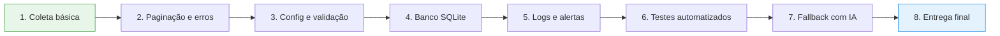

# 🗺️ Roadmap — Scraper Híbrido

> Um scraper que não quebra em silêncio: coleta com seletores, detecta quando o site muda, avisa e usa IA como plano B — com cada etapa testada.

---

## 📍 Visão geral

**Prazo estimado:** 12 a 17 dias de trabalho (cerca de 2 a 3 semanas).

---

## 📊 Progresso

| # | Fase | Estimativa | Status |
|---|------|:----------:|:------:|
| 1 | Coleta básica | 1–2 dias | ✅ Concluída |
| 2 | Paginação + erros + retentativas | 1–2 dias | ✅ Concluída |
| 3 | Seletores em config + validação | 1–2 dias | ⬜ A fazer |
| 4 | SQLite + duplicatas + comparação | 2 dias | ⬜ A fazer |
| 5 | Logs + alerta de quebra | 1 dia | ⬜ A fazer |
| 6 | Testes com páginas salvas | 2 dias | ⬜ A fazer |
| 7 | Fallback com IA + validação | 3–4 dias | ⬜ A fazer |
| 8 | README, GIF e executável | 1–2 dias | ⬜ A fazer |

Legenda: ⬜ A fazer · 🟨 Em andamento · ✅ Concluída

---

## 🔍 Detalhes de cada fase

### 1️⃣ Coleta básica · `1–2 dias`
**Objetivo:** extrair os campos certos de uma página e exportar para CSV.
- [x] Requisição HTTP com cabeçalhos adequados
- [x] Extração dos campos definidos
- [x] Exportação para `.csv`

> 💡 **Demonstra:** fundamentos de scraping e manipulação de dados.

### 2️⃣ Paginação e resiliência · `1–2 dias`
**Objetivo:** percorrer várias páginas sem travar em falhas de rede.
- [x] Navegação automática entre páginas
- [x] Tratamento de erros (timeout, 404, 500)
- [x] Retentativas com espera progressiva

> 💡 **Demonstra:** código robusto para o mundo real, onde a rede falha.

### 3️⃣ Configuração e validação · `1–2 dias`
**Objetivo:** trocar de site sem mexer no código.
- [ ] Seletores num arquivo de configuração
- [ ] Validação de cada registro coletado (campos vazios, tipos, formatos)

> 💡 **Demonstra:** separação entre lógica e configuração; reaproveitamento para novos clientes.

### 4️⃣ Banco de dados · `2 dias`
**Objetivo:** guardar histórico e detectar mudanças.
- [ ] Armazenamento em SQLite
- [ ] Prevenção de duplicatas
- [ ] Comparação entre coletas (o que entrou, saiu ou mudou)

> 💡 **Demonstra:** persistência de dados e monitoramento ao longo do tempo.

### 5️⃣ Observabilidade · `1 dia`
**Objetivo:** saber o que aconteceu, e ser avisado quando algo quebrar.
- [ ] Logs estruturados de cada execução
- [ ] Alerta quando o layout do site muda e a coleta falha

> 💡 **Demonstra:** postura profissional — falhas visíveis, não silenciosas.

### 6️⃣ Testes automatizados · `2 dias`
**Objetivo:** garantir que tudo funciona sem depender do site estar no ar.
- [ ] Páginas HTML salvas como base de teste
- [ ] Testes para extração, validação e banco

> 💡 **Demonstra:** qualidade de software verificável.

### 7️⃣ Fallback com IA · `3–4 dias`
**Objetivo:** quando os seletores quebram, a IA tenta extrair os dados.
- [ ] Acionamento automático quando a coleta normal falha
- [ ] Validação rigorosa do que a IA devolve (a IA pode errar)
- [ ] Registro de quando o fallback foi usado

> 💡 **Demonstra:** uso responsável de IA — como plano B controlado, não como mágica.

### 8️⃣ Entrega final · `1–2 dias`
**Objetivo:** projeto fácil de entender e de usar.
- [ ] README completo com instruções
- [ ] GIF mostrando o scraper em ação
- [ ] Executável (`.exe`) para quem não usa Python

> 💡 **Demonstra:** capacidade de entregar um produto, não só código.

---

## 🧰 Stack prevista

`Python` · `requests` · `BeautifulSoup` · `SQLite` · `pytest` · `logging` · `API de IA` · `PyInstaller`

---

<i>Roadmap atualizado conforme o desenvolvimento avança.</i>
